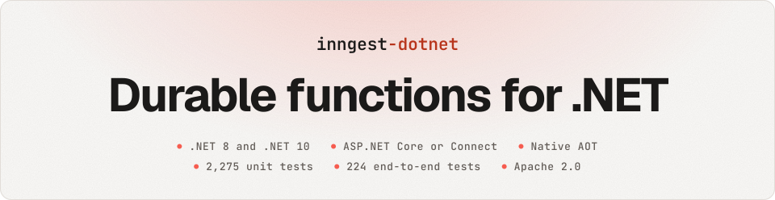

<div align="center">

<picture>
  <source media="(prefers-color-scheme: dark)" srcset=".github/assets/banner-dark.svg">
  
</picture>

Write background jobs and workflows as plain C# methods. Inngest runs every step once, retries only what fails and
lets a run wait for days, so you ship reliable workflows without queues, state tables or cron glue.

[](https://github.com/damikun/inngest-dotnet/actions/workflows/ci.yml)
[](https://www.nuget.org/packages/Inngest)
[](LICENSE)

[Documentation](https://damikun.github.io/inngest-dotnet/) ·
[Getting started](https://damikun.github.io/inngest-dotnet/guides/getting-started/) ·
[How it works](https://damikun.github.io/inngest-dotnet/how-it-works/) ·
[Examples](https://damikun.github.io/inngest-dotnet/examples/order-fulfillment/)

</div>

inngest-dotnet is a community .NET SDK for [Inngest](https://www.inngest.com). It is a C# port of the Inngest
TypeScript SDK, [inngest-js](https://github.com/inngest/inngest-js), and it follows .NET conventions: dependency
injection, `IOptions`, `ILogger`, `CancellationToken`, `TimeSpan` and plain `Task`-based code. Serve your functions
from ASP.NET Core, or from a worker that needs no public endpoint.

<p align="center">
<picture>
  <source media="(prefers-color-scheme: dark)" srcset=".github/assets/how-a-run-works-dark.svg">
  
</picture>
</p>

Inngest runs each step once and keeps its result. When `send-receipt` fails, Inngest retries that step alone, so the
card is not charged again, and a sleep holds no thread or worker while it waits.

## Ordinary C#, durable by default

A function is a class. Its attributes give it an id and the event that starts it. Each call to a step tool, such as
`RunAsync` or `SleepAsync`, is a step. The rest is plain C#.

```csharp
using Inngest;

public sealed record OrderPaid(string OrderId, string CustomerId, decimal Amount);

[InngestFunction("checkout")]
[EventTrigger("shop/order.paid")]
public sealed class CheckoutFunction(IPayments pay, IMailer mail, IWarehouse warehouse)
    : InngestFunction<OrderPaid>
{
    public override async Task<object?> ExecuteAsync(
        FunctionContext<OrderPaid> context, CancellationToken cancellationToken)
    {
        var order = context.Event.Data;

        var charge = await context.Step.RunAsync("charge",
            ct => pay.ChargeAsync(order, ct));

        await context.Step.RunAsync("send-receipt",
            ct => mail.SendReceiptAsync(order, ct));

        await context.Step.SleepAsync("cooling-off",
            TimeSpan.FromMinutes(30));

        await context.Step.RunAsync("ship",
            ct => warehouse.ShipAsync(order, ct));

        return new { charge.Id };
    }
}
```

- **`charge` runs once.** Inngest stores the charge it returns. Later calls get that stored result instead of
  charging again.
- **A failure retries one step.** If the mail server fails, Inngest retries `send-receipt` alone, and the charge
  stays done.
- **The sleep holds nothing.** `SleepAsync` ends the call, and Inngest calls the function again in 30 minutes.
  Nothing runs or waits in your app meanwhile, and deploys in between do not matter.
- **`return` completes the run.** The SDK reports the output and Inngest marks the run completed.

## Why durable execution

Checkout flows, onboarding emails, billing runs and webhook handlers call systems that fail, and some have to wait
for days. With durable steps, a failure costs one retry of one step, not a second charge.

- **A retry repeats only what failed.** Inngest saves each step's result. When an API returns a `500` or the process
  crashes, the retry runs the step that failed, not the charge and the email before it.
- **Runs can wait for days.** A run can sleep until a date or wait for an event, such as a payment or a reply,
  without a worker, a timer or a table of your own. The app can deploy, restart or scale down in the meantime.
- **No queue plumbing.** Concurrency limits, throttling, rate limits, debounce, batching and cancellation are options
  on the function. Inngest enforces them and keeps the history of every run.

## Features

| Feature | What you write |
|---|---|
| **Steps that run once** | `context.Step.RunAsync(id, handler)` saves the result, and a retry resumes after the last step that finished. |
| **Sleep and wait for events** | `SleepAsync`, `SleepUntilAsync` and `WaitForEventAsync<T>` pause a run without holding a thread, a request or a worker. |
| **Parallel steps** | Start steps together and `await Task.WhenAll(...)`. Inngest runs each in its own call. |
| **A scope per step** | `RunScopedAsync` runs a step in a dependency injection scope of its own, so a `DbContext` never carries state from one step or call to the next. |
| **Functions that call functions** | `InvokeAsync<T>` runs another function and returns its result. `SendEventAsync` sends events exactly once. |
| **Triggers** | Events, events filtered with an expression, and cron schedules with a time zone. |
| **Flow control** | Concurrency with keys, throttling, rate limits, debounce, batching, priority, idempotency and singletons, as attributes on the function or options in `FunctionOptions`. |
| **Errors and retries** | Every step retries on its own. `NonRetriableException` stops, `RetryAfterException` sets the delay, and a failure handler runs when a function fails for good. |
| **Cancellation and timeouts** | `CancelOn` stops a run when a matching event arrives. `Timeouts` cancel a run that waits too long to start or takes too long to finish. |
| **Middleware** | `InngestMiddleware` observes or wraps runs, steps and event sends, with dependencies from DI. |
| **AI calls** | `InferAsync` has Inngest make the model call; `AIWrapAsync` runs your own call as a step that the Inngest UI shows with its input. `Inngest.Extensions.AI` makes the model calls and tool calls of a Microsoft.Extensions.AI `IChatClient` steps. |
| **Realtime** | `PublishAsync` and `PublishStreamAsync` send updates and model output from a run, `SubscribeAsync` receives them in .NET, and `MapInngestRealtime` relays them to browsers as server-sent events. |
| **Sessions** | Events name the sessions they belong to, and what a run sends or invokes inherits them, so related runs group together. |
| **Durable endpoints** | `WithDurableEndpoint` or `[DurableEndpoint]` makes an ASP.NET Core endpoint run steps like a function. The caller gets the response directly, and Inngest takes the run over when a step has to wait or fails. Beta in Inngest, so the .NET API is marked experimental. |
| **Two ways to serve** | `MapInngest` adds the endpoint Inngest calls to an ASP.NET Core app, and can stream long calls through load balancers. `AddConnect` runs a worker over an outbound WebSocket instead. |
| **Signed requests** | In cloud mode every request from Inngest is verified and every response is signed, with a fallback key for key rotation. |
| **.NET conventions** | Functions are classes resolved from DI, or delegates. Settings come from `IOptions` and the usual `INNGEST_*` variables. Logs go to `ILogger`. |

Waiting for an event is one call. It returns `null` when the timeout passes first:

```csharp
var activated = await context.Step.WaitForEventAsync<UserActivated>(
    "wait-for-activation",
    new WaitForEventOptions("user/activated", TimeSpan.FromDays(3)) { Match = "data.userId" });

if (activated is null)
{
    await context.Step.RunAsync("send-reminder",
        ct => email.SendAsync(user.Email, "Your account is waiting", ct));
}
```

Flow control is a set of attributes on the function, or options in code. Inngest enforces them:

```csharp
[InngestFunction("sync-account")]
[EventTrigger("account/updated")]
[Concurrency(1, Key = "event.data.accountId")]
[Throttle(10, "1m")]
[CancelOn("account/deleted", Match = "data.accountId")]
```

## How it works

<picture>
  <source media="(prefers-color-scheme: dark)" srcset="site/src/assets/architecture-dark.svg">
  
</picture>

Inngest stores the run and calls your app for each step. Your app keeps no state between calls. The SDK replays the
function and tells Inngest what to do next.

1. **An event starts a run.** Your code, a webhook or a schedule sends an event such as `shop/order.paid`, and
   Inngest starts a run of every function it triggers.
2. **Each call replays the function.** Inngest calls `/api/inngest` with the results of the steps that already
   finished. The SDK hands them back at once, so the function picks up where it stopped.
3. **The answer says what is next.** The SDK answers `206` with the step it ran or reached, such as a sleep, or `200`
   with the output once the function returns.

With Connect, the same functions run in a worker that opens a WebSocket to Inngest. Executions arrive over the
socket and results go back over it, so the worker needs no public endpoint and can run behind a firewall.

[Step through a real run, call by call](https://damikun.github.io/inngest-dotnet/how-it-works/)

## Packages

| Package | What it gives you |
|---|---|
| [`Inngest`](https://www.nuget.org/packages/Inngest/) | Functions, steps, triggers, flow control, middleware, the client that sends events, and request signing. A source generator that registers your function classes, which a project turns on, and an analyzer that finds the types a Native AOT app has not listed, come with it. Its only dependencies are `Microsoft.Extensions.*` packages. |
| [`Inngest.AspNetCore`](https://www.nuget.org/packages/Inngest.AspNetCore/) | `MapInngest`, the endpoint Inngest calls in an ASP.NET Core app, and a health check for readiness probes. |
| [`Inngest.AwsLambda`](https://www.nuget.org/packages/Inngest.AwsLambda/) | `InngestLambdaHandler`, which serves the endpoint from an AWS Lambda function behind API Gateway or a function URL, as a managed runtime function or a Native AOT executable. |
| [`Inngest.AzureFunctions`](https://www.nuget.org/packages/Inngest.AzureFunctions/) | `ServeInngestAsync`, the endpoint Inngest calls, served from an HTTP-triggered function of an Azure Functions app in the isolated worker model. |
| [`Inngest.Blazor`](https://www.nuget.org/packages/Inngest.Blazor/) | `RealtimeView`, a Blazor component that shows realtime messages on the server, in WebAssembly and in interactive Auto, and `IRealtimeSource`, which gives them as an async stream. |
| [`Inngest.Connect`](https://www.nuget.org/packages/Inngest.Connect/) | `AddConnect`, a hosted worker that receives calls over an outbound WebSocket, with no endpoint to expose. |
| [`Inngest.Aspire.Hosting`](https://www.nuget.org/packages/Inngest.Aspire.Hosting/) | An Aspire hosting integration: runs the Inngest dev server, or a self-hosted server, as a container of the AppHost, links its UI in the dashboard and gives projects the settings the SDK reads. |
| [`Inngest.Testing`](https://www.nuget.org/packages/Inngest.Testing/) | An in-memory test host that runs your functions on the real execution engine. |
| [`Inngest.Testing.Containers`](https://www.nuget.org/packages/Inngest.Testing.Containers/) | A Testcontainers module that runs the Inngest dev server or a self-hosted server in Docker for end-to-end tests. |
| [`Inngest.Testing.Containers.AspNetCore`](https://www.nuget.org/packages/Inngest.Testing.Containers.AspNetCore/) | A `WebApplicationFactory` that runs an ASP.NET Core app on a real port against that server (.NET 10). |
| [`Inngest.OpenTelemetry`](https://www.nuget.org/packages/Inngest.OpenTelemetry/) | Traces and metrics for function calls and steps. |
| [`Inngest.Encryption`](https://www.nuget.org/packages/Inngest.Encryption/) | End-to-end encryption of event data, step results and function output, in the format of the TypeScript SDK's encryption middleware. |
| [`Inngest.Sentry`](https://www.nuget.org/packages/Inngest.Sentry/) | Reports the errors of functions and steps to Sentry, tagged with the app, the function, the run and the event. |
| [`Inngest.Extensions.AI`](https://www.nuget.org/packages/Inngest.Extensions.AI/) | Makes the model calls and tool calls of a Microsoft.Extensions.AI `IChatClient` steps of the run, so a replay never calls the model or a tool twice. |
| [`Inngest.EntityFrameworkCore`](https://www.nuget.org/packages/Inngest.EntityFrameworkCore/) | A transactional outbox for Entity Framework Core: events saved in the same transaction as your data and sent to Inngest afterwards, under the same id on every attempt. |
| [`Inngest.Templates`](https://www.nuget.org/packages/Inngest.Templates/) | `dotnet new inngest-web` and `dotnet new inngest-worker`: a project with a typed event, a function and dev mode in its Development settings. |
| [`dotnet-inngest`](https://www.nuget.org/packages/dotnet-inngest/) | A .NET tool: `dotnet inngest dev` downloads the Inngest CLI, checks its SHA-256 and runs the dev server for the app in the current folder. |
| [`Inngest.SignalR`](https://www.nuget.org/packages/Inngest.SignalR/) | Forwards Inngest realtime messages to the clients of a SignalR hub, with one subscription to Inngest shared by the clients of a channel. |
| [`Inngest.Webhooks`](https://www.nuget.org/packages/Inngest.Webhooks/) | Verifies the signatures of webhooks from Stripe, GitHub, Shopify, Standard Webhooks senders such as Clerk and Resend, and any HMAC, and sends each as an event whose id is the delivery id. `MapInngestWebhook` is in `Inngest.AspNetCore`, which brings it in. |

Each package targets `net8.0` and `net10.0`, except `Inngest.Testing.Containers.AspNetCore`, which targets `net10.0`;
the template package holds files only.

## Quick start

1. **Install the SDK.** `Inngest.AspNetCore` brings in `Inngest`. The version is a preview, so add `--prerelease`:

   ```bash
   dotnet add package Inngest.AspNetCore --prerelease
   ```

   Or reference it in your project file. `*-*` restores the newest version, previews included; put a version
   such as `0.1.0-preview.3` there instead to pin it:

   ```xml
   <ItemGroup>
     <PackageReference Include="Inngest.AspNetCore" Version="*-*" />
   </ItemGroup>
   ```

   For a worker with no public endpoint, install `Inngest.Connect` instead.

2. **Register the function and map the endpoint.** `AddInngest` registers the SDK and your functions, and
   `MapInngest` maps the endpoint Inngest calls:

   ```csharp
   using Inngest;

   var builder = WebApplication.CreateBuilder(args);

   // Register IPayments, IMailer and IWarehouse as usual. CheckoutFunction gets them from DI.
   builder.Services
       .AddInngest(options => options.AppId = "shop")
       .AddFunction<CheckoutFunction>();

   var app = builder.Build();
   app.MapInngest("/api/inngest");
   app.Run();
   ```

3. **Start the app in dev mode.** `INNGEST_DEV=1` points the SDK at the local dev server:

   ```bash
   INNGEST_DEV=1 dotnet run --urls http://localhost:5280
   ```

4. **Start the [Inngest dev server](https://www.inngest.com/docs/local-development)** and point it at the app, with
   Node.js:

   ```bash
   npx --ignore-scripts=false inngest-cli@latest dev -u http://localhost:5280/api/inngest
   ```

   Or with Docker:

   ```bash
   docker run --rm -p 8288:8288 -p 8289:8289 inngest/inngest:v1.49.0 inngest dev -u http://host.docker.internal:5280/api/inngest
   ```

   On Linux without Docker Desktop, add `--add-host=host.docker.internal:host-gateway`.

5. **Send an event** with `IInngestClient`, from an endpoint, a controller or a background service:

   ```csharp
   await inngest.SendAsync(
       new InngestEvent("shop/order.paid", new OrderPaid("o_123", "c_42", 59.90m)));
   ```

   Open http://localhost:8288 and watch the run go step by step.

[Getting started](https://damikun.github.io/inngest-dotnet/guides/getting-started/) walks through a complete app,
with the other ways to install the dev server.

## Samples

| Sample | What it shows |
|---|---|
| [`samples/Inngest.Sample`](samples/Inngest.Sample) | An ASP.NET Core app with an onboarding flow that waits for the user to activate and stops when the account is deleted, a cron job that fans out with `InvokeAsync`, and a delegate function. It comes with a Dockerfile and a Compose file with dev and cloud profiles. |
| [`samples/Inngest.AotSample`](samples/Inngest.AotSample) | An app published as a Native AOT binary, with no trimming or AOT warnings. |
| [`samples/Inngest.Sample.AppHost`](samples/Inngest.Sample.AppHost) | An Aspire AppHost for `Inngest.Sample`: `dotnet run --project samples/Inngest.Sample.AppHost` starts the dev server in Docker, the sample next to it and the Aspire dashboard, with no other setup. |

The documentation has complete examples:

| Example | What it shows |
|---|---|
| [Order fulfillment](https://damikun.github.io/inngest-dotnet/examples/order-fulfillment/) | Reserve stock, charge the card, ship and confirm, release the stock when payment fails, and cancel on request. |
| [User onboarding](https://damikun.github.io/inngest-dotnet/examples/user-onboarding/) | Wait up to three days for a user to activate, and send a reminder if they do not. |
| [Nightly billing](https://damikun.github.io/inngest-dotnet/examples/nightly-billing/) | A cron function that fans out one event per account, billed with its own retries and limits. |
| [Webhook pipeline](https://damikun.github.io/inngest-dotnet/examples/webhook-pipeline/) | Accept webhooks quickly, then process each delivery with idempotency and a per-merchant throttle. |
| [Fan-out with invoke](https://damikun.github.io/inngest-dotnet/examples/fan-out-with-invoke/) | Invoke one function per region in parallel, and finish the report even when a region fails. |
| [Scheduled reminders](https://damikun.github.io/inngest-dotnet/examples/scheduled-reminders/) | Sleep until a reminder is due, and cancel or replace the pending run when the reminder changes. |
| [Tracing middleware](https://damikun.github.io/inngest-dotnet/examples/tracing-middleware/) | Wrap every call and step in an `Activity` with tags for the function, the run and the step. |
| [Connect worker](https://damikun.github.io/inngest-dotnet/examples/connect-worker/) | A worker with no HTTP endpoint, a web app that only sends events, a Dockerfile and graceful shutdown. |

## Compatibility

| | |
|---|---|
| .NET | .NET 8 and .NET 10 (`net8.0`, `net10.0`) |
| Hosting | ASP.NET Core with `MapInngest`, or any generic host with `AddConnect` |
| Native AOT and trimming | Compatible, except `Inngest.EntityFrameworkCore`, which runs on Entity Framework Core, and the packages for tests and the Aspire app host, which are never compiled ahead of time. The SDK uses source-generated JSON for its own types; you add a `JsonSerializerContext` for yours, and an analyzer lists the types you forgot. See [Native AOT and trimming](https://damikun.github.io/inngest-dotnet/guides/native-aot/). |
| Inngest | Inngest Cloud, [self-hosted Inngest](https://www.inngest.com/docs/platform-and-operations/self-host-inngest), or the dev server. Tested against `inngest/inngest` v1.49.0. |
| Ported from | inngest-js v4.26.2 |

## Quality and testing

- **3,144 unit tests** pass on .NET 10, and the 3,008 of them in projects that also target .NET 8 pass on .NET 8,
  including concurrency stress tests with thousands of invocations at once.
- **327 integration and end-to-end tests** run against the real Inngest server, `inngest/inngest` v1.49.0, in three
  setups: dev mode, a self-hosted server with signing keys (cloud mode), and over Connect.
- **8,000 of 8,000 runs** completed under sustained load in dev mode, and again in cloud mode. Memory stayed flat
  over 8 million engine invocations and 1.6 million signed HTTP calls.
- **Native AOT**: CI publishes the AOT sample and the AWS Lambda sample with zero warnings, and starts the AOT
  sample's native binary.
- **Strict builds**: warnings are errors, code style is enforced in the build, and the packages include Source Link
  and symbol packages.

The [readiness report](https://damikun.github.io/inngest-dotnet/internals/readiness/) has the details and the raw
data.

## Documentation

- **Start:** [Getting started](https://damikun.github.io/inngest-dotnet/guides/getting-started/) ·
  [How it works](https://damikun.github.io/inngest-dotnet/how-it-works/) ·
  [Templates and tool](https://damikun.github.io/inngest-dotnet/guides/templates-and-tools/)
- **Guides:** [Functions and triggers](https://damikun.github.io/inngest-dotnet/guides/functions-and-triggers/) ·
  [Steps](https://damikun.github.io/inngest-dotnet/guides/steps/) ·
  [Scoped steps](https://damikun.github.io/inngest-dotnet/guides/scoped-steps/) ·
  [Sleep and wait for events](https://damikun.github.io/inngest-dotnet/guides/sleep-and-wait-for-events/) ·
  [Parallel steps](https://damikun.github.io/inngest-dotnet/guides/parallel-steps/) ·
  [Invoking functions](https://damikun.github.io/inngest-dotnet/guides/invoking-functions/) ·
  [Sending events](https://damikun.github.io/inngest-dotnet/guides/sending-events/) ·
  [Transactional outbox](https://damikun.github.io/inngest-dotnet/guides/outbox/) ·
  [Webhooks](https://damikun.github.io/inngest-dotnet/guides/webhooks/) ·
  [Realtime](https://damikun.github.io/inngest-dotnet/guides/realtime/) ·
  [Durable endpoints](https://damikun.github.io/inngest-dotnet/guides/durable-endpoints/) ·
  [AI chat clients](https://damikun.github.io/inngest-dotnet/guides/ai/) ·
  [Flow control](https://damikun.github.io/inngest-dotnet/guides/flow-control/) ·
  [Errors and retries](https://damikun.github.io/inngest-dotnet/guides/errors-and-retries/) ·
  [Middleware](https://damikun.github.io/inngest-dotnet/guides/middleware/) ·
  [Connect](https://damikun.github.io/inngest-dotnet/guides/connect/) ·
  [Aspire](https://damikun.github.io/inngest-dotnet/guides/aspire/) ·
  [Configuration](https://damikun.github.io/inngest-dotnet/guides/configuration/) ·
  [Deploying](https://damikun.github.io/inngest-dotnet/guides/deploying/) ·
  [Native AOT](https://damikun.github.io/inngest-dotnet/guides/native-aot/) ·
  [Source generator and analyzers](https://damikun.github.io/inngest-dotnet/guides/source-generator/) ·
  [Testing](https://damikun.github.io/inngest-dotnet/guides/testing/) ·
  [Testing with containers](https://damikun.github.io/inngest-dotnet/guides/testing-with-containers/)
- **Try it in the browser:** [Function options builder](https://damikun.github.io/inngest-dotnet/explainers/function-options/) ·
  [Flow control timeline](https://damikun.github.io/inngest-dotnet/explainers/flow-control/)
- **Reference:** [API overview](https://damikun.github.io/inngest-dotnet/reference/api/) ·
  [Design and wire protocol](https://damikun.github.io/inngest-dotnet/internals/design/) ·
  [Benchmarks](https://damikun.github.io/inngest-dotnet/internals/benchmarks/)
- **For AI coding assistants:** [AI coding assistants](https://damikun.github.io/inngest-dotnet/guides/ai-assistants/)
  lists the names that differ from the TypeScript SDK and the rules of replay, with a block to paste into
  `AGENTS.md`, `CLAUDE.md` or Cursor rules. [`llms.txt`](https://damikun.github.io/inngest-dotnet/llms.txt) links every
  page as Markdown, and [`llms-full.txt`](https://damikun.github.io/inngest-dotnet/llms-full.txt) holds them all in one
  file. Every page also has a Markdown copy at its address with `.md` in place of the trailing slash.
- **Inngest itself:** the [Inngest documentation](https://www.inngest.com/docs) covers the platform, the dashboard
  and self-hosting.

## Contributing

Issues and pull requests are welcome. Build the solution and run the unit tests:

```bash
dotnet build Inngest.slnx
```

```bash
dotnet test --project tests/Inngest.Tests/Inngest.Tests.csproj
```

Some packages have test projects of their own under [`tests/`](tests): the chat clients
(`Inngest.Extensions.AI.Tests`), the outbox on SQLite (`Inngest.EntityFrameworkCore.Tests`), the source generator
(`Inngest.SourceGeneration.Tests`), the templates (`Inngest.Templates.Tests`, which pack the packages and build what the
templates make) and the Aspire integration (`Inngest.Aspire.Hosting.Tests`, whose `Containers` tests need Docker). They
run the same way:

```bash
dotnet test --project tests/Inngest.EntityFrameworkCore.Tests/Inngest.EntityFrameworkCore.Tests.csproj
```

The integration tests start the Inngest server, and PostgreSQL for the outbox, with Testcontainers, so they need Docker:

```bash
dotnet test --project tests/Inngest.IntegrationTests/Inngest.IntegrationTests.csproj
```

The documentation site lives in [`site/`](site) and is built with Astro and Starlight. The
[design notes](https://damikun.github.io/inngest-dotnet/internals/design/) describe the wire protocol and the
internals.

## License

Apache License 2.0. See [LICENSE](LICENSE).

inngest-dotnet is a C# port of [inngest-js](https://github.com/inngest/inngest-js), Copyright 2022 Inngest Inc., also
licensed under the Apache License 2.0. See [NOTICE](NOTICE). This project is not affiliated with or endorsed by
Inngest Inc. "Inngest" is a trademark of Inngest Inc.
