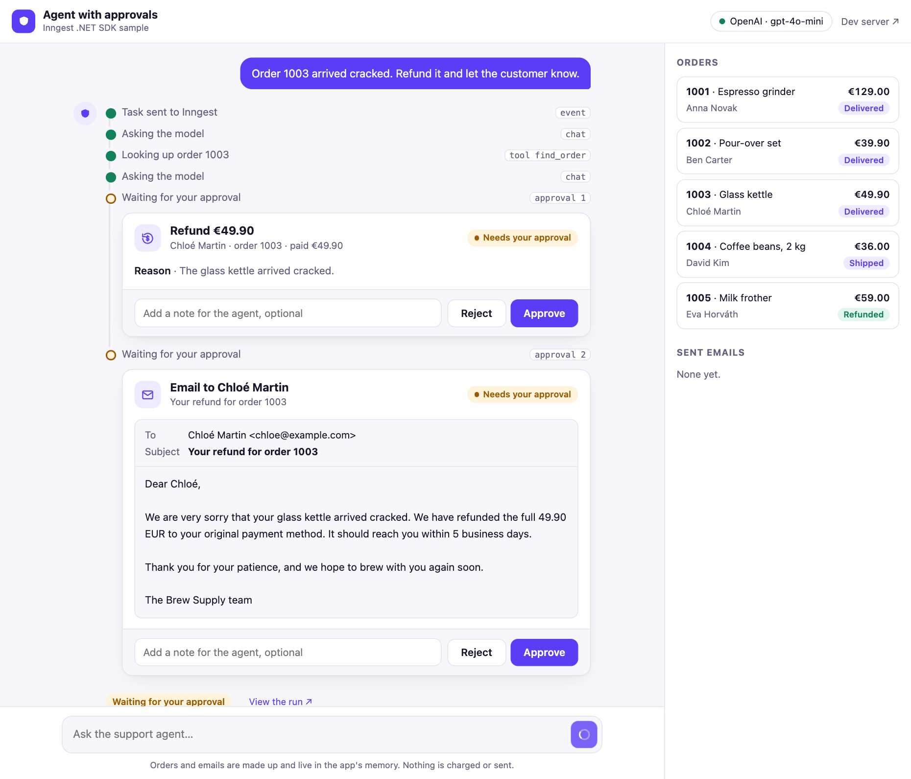
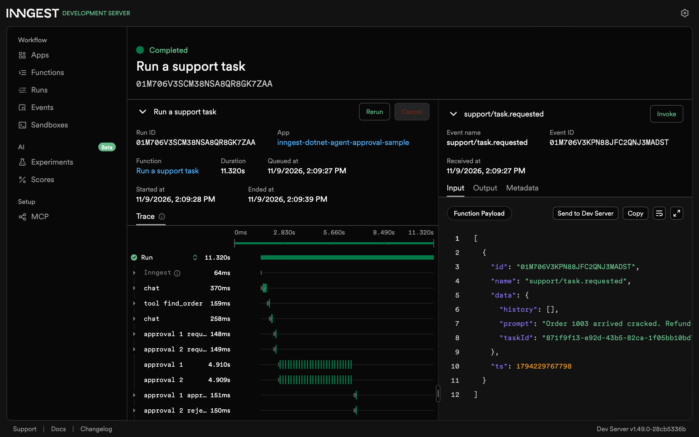

# Agent with approvals sample

The support desk of a small coffee shop. You give the agent a task, such as "order 1003 arrived cracked, refund it". It
looks orders up on its own, but every refund and every email waits until a person approves it. The agent runs in an
Inngest function with [`Inngest.Extensions.AI`](https://damikun.github.io/inngest-dotnet/guides/ai/), and the wait is a
step: it holds no thread or memory, survives restarts and deploys, and ends after a day if no one answers.

<picture>
  <source media="(prefers-color-scheme: dark)" srcset="images/approval-dark.png">
  
</picture>

## How it works

The tools that need a person are wrapped in `ApprovalRequiredAIFunction` from Microsoft.Extensions.AI. When the model
calls one, the function invoking client doesn't run it. It returns a `ToolApprovalRequestContent` instead, and the
function asks the page and waits. In short, with one request at a time:

```csharp
var response = await chat.GetStreamingResponseAsync(messages, options).ToChatResponseAsync();
messages.AddRange(response.Messages);

foreach (var request in response.Messages.SelectMany(m => m.Contents).OfType<ToolApprovalRequestContent>())
{
    var n = ++approvals;
    await context.Step.PublishAsync($"approval {n} requested", status, /* the tool and its arguments */);

    var decision = await context.Step.WaitForEventAsync<ApprovalDecided>(
        $"approval {n}", TimeSpan.FromDays(1),
        @if: $"async.data.taskId == event.data.taskId && async.data.approval == {n}");

    messages.Add(new ChatMessage(ChatRole.User, [request.CreateResponse(decision?.Data.Approved ?? false, decision?.Data.Note)]));
}

// The next call runs the approved tools, each as a step, and tells the model which were rejected and why.
```

1. The page sends the task to `POST /api/tasks`, and the app sends Inngest a `support/task.requested` event.
2. The function calls the model. `find_order` runs right away. `issue_refund` and `send_email` come back as approval
   requests, which the function publishes to the page through realtime.
3. The function waits for a `support/approval.decided` event for each request, all at once.
4. Approve or Reject on the page sends that event. A note goes with it, such as "make it shorter".
5. The function passes the decisions to the next model call. The approved tools run once, as steps. A rejected tool
   isn't called, and the model gets the note and can try again.
6. The answer streams back to the page, and the orders and sent emails on the side show what happened.

## Run it

The agent needs a model key. It goes in [user secrets](https://learn.microsoft.com/aspnet/core/security/app-secrets),
outside the repository:

```bash
dotnet user-secrets set Anthropic:ApiKey sk-ant-... --project samples/Inngest.AgentApprovalSample
```

`OpenAI:ApiKey` works too. With both set, `Agent:Provider` (`anthropic` or `openai`) picks one. Then start the app and
the dev server, each in its own terminal:

```bash
dotnet run --project samples/Inngest.AgentApprovalSample
```

```bash
dotnet tool install --global dotnet-inngest
cd samples/Inngest.AgentApprovalSample && dotnet inngest dev
```

Open http://localhost:5292 and try one of the example tasks. Things to try:

- Reject the email with a note, such as "shorter, and mention the 5 days". The agent writes a new one.
- Stop the app while a card waits, start it again, then approve. The run carries on where it was, and the page
  reconnects to its updates.
- Leave a card alone. After `Agent:ApprovalTimeout`, a day by default, the run treats it as rejected.

The dev server at http://localhost:8288 shows each run with its steps. A wait shows as `approval 1`.



## Files

- `RunSupportAgent.cs`: the function, with the loop above and the failure handler that tells the page.
- `SupportTools.cs`: `find_order`, and `issue_refund` and `send_email` wrapped in `ApprovalRequiredAIFunction`.
- `ModelClient.cs`: builds the Anthropic or OpenAI client from configuration, with `UseInngestFunctionInvocation` and
  `UseInngestSteps`.
- `Shop.cs`: five orders and an outbox, made up and kept in memory.
- `Program.cs`: starts tasks, takes decisions, and serves each task's updates with `MapInngestRealtime`.
- `wwwroot/index.html`: the page, plain HTML and JavaScript.

## Notes

- The [AI agent sample](../Inngest.AiAgentSample) takes the key on the page and keeps it in memory for a few minutes.
  That doesn't work here, as a run can wait for a day and outlive the process. The key is the app's own, from
  configuration. It is read when the function runs and is never part of an event or a step.
- A model turn that asks for several approvals shows them all at once. Its tools run when all of them are decided.
- `ToolApprovalRequestContent.RequiresConfirmation` is still marked experimental in Microsoft.Extensions.AI, so the
  project file allows `MEAI001`.
- The decision event has an id made of the task and the approval number, so a second click is dropped.
- Anyone who knows a task id can decide for it and read its updates. A real app would check who is signed in, for
  example that only a manager approves refunds, and could put the approver in the event with `Inngest.UserContext`.
