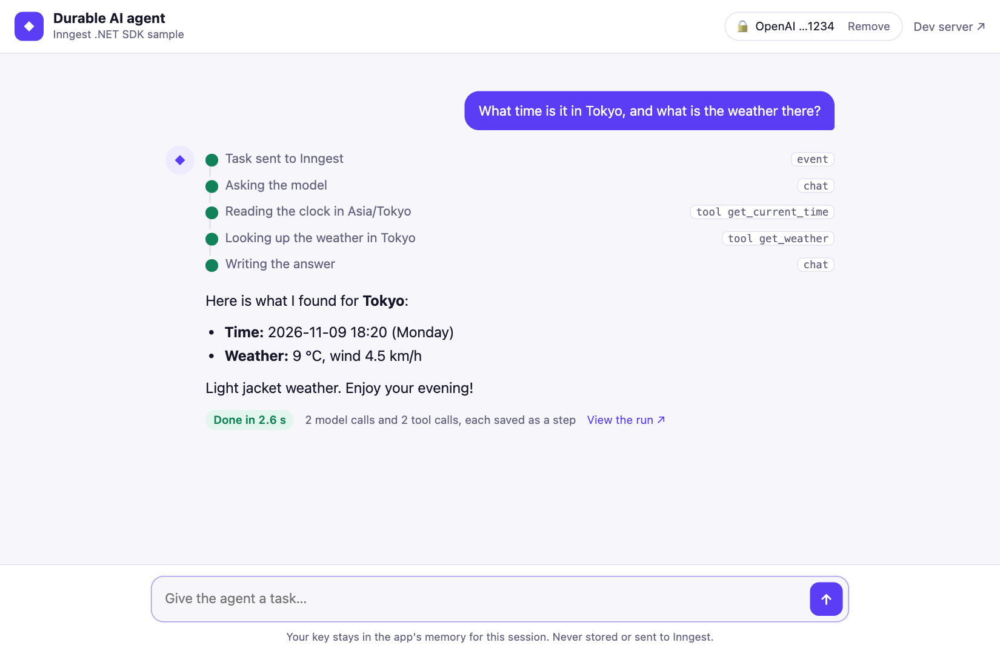
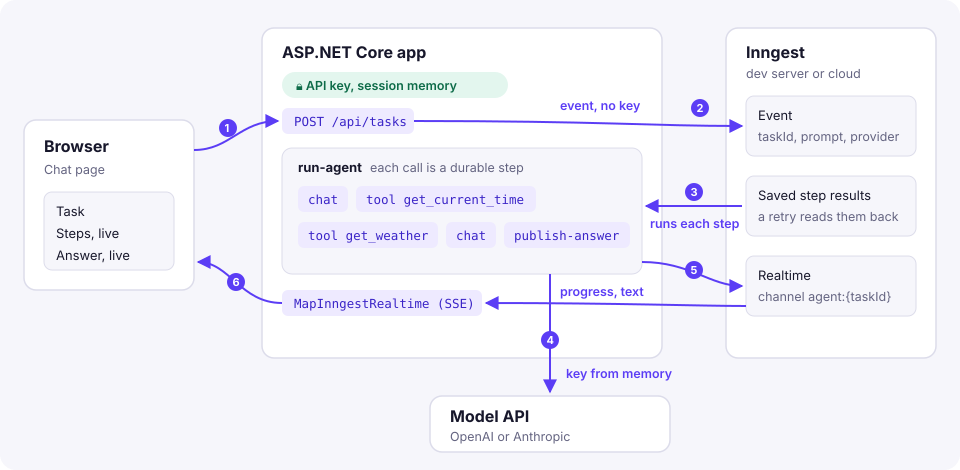
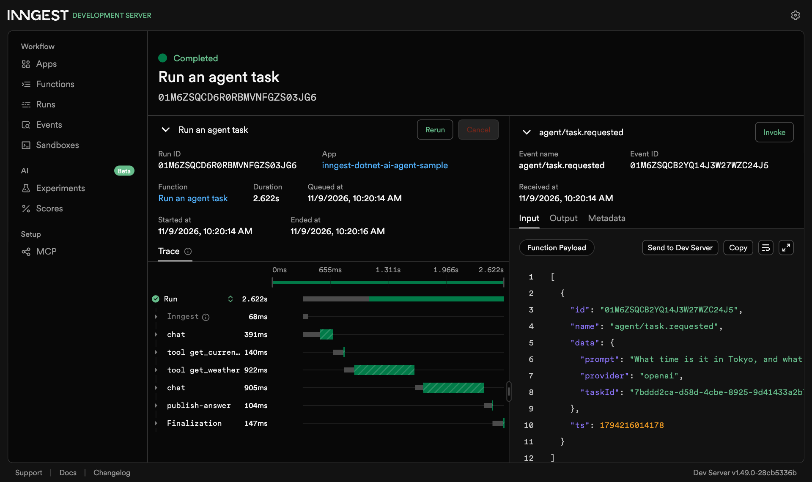

# AI agent sample

A chat page where you pick OpenAI or Anthropic, save your API key and give an agent a task. An Inngest function runs
the agent loop with [`Inngest.Extensions.AI`](https://damikun.github.io/inngest-dotnet/guides/ai/):
`UseInngestFunctionInvocation` and `UseInngestSteps` on a Microsoft.Extensions.AI `IChatClient` make every model call
and tool call a step, so a retry never calls the model or a tool twice. Progress and the answer stream back to the
page through [realtime](https://damikun.github.io/inngest-dotnet/guides/realtime/).

<picture>
  <source media="(prefers-color-scheme: dark)" srcset="images/chat-dark.png">
  
</picture>

## How it works



1. The page saves the key once, then sends tasks to `POST /api/tasks`.
2. The app keeps the key in memory and sends Inngest an event with only the task id, the prompt and the provider.
3. Inngest calls the `run-agent` function for every step and keeps each result.
4. Model calls go straight from the app to OpenAI or Anthropic, with the key from memory.
5. The function publishes progress and the streamed text to the task's realtime channel.
6. The page reads that channel as server-sent events through `MapInngestRealtime`.

## Run it

Start the app and the dev server, each in its own terminal:

```bash
dotnet run --project samples/Inngest.AiAgentSample
```

```bash
dotnet tool install --global dotnet-inngest
cd samples/Inngest.AiAgentSample && dotnet inngest dev
```

Open http://localhost:5290, save your key and send a task. The dev server UI at http://localhost:8288 shows each run
with its steps: `chat` for a model call, `tool get_current_time` and `tool get_weather` for the tools. The event on the
right holds the prompt and the provider, and no key.



The default models are `gpt-4o-mini` and `claude-opus-5-5`. Change them with `Agent:OpenAIModel` and
`Agent:AnthropicModel`. `Agent:OpenAIEndpoint` points the OpenAI option at any server with the same API, such as Ollama:

```bash
Agent__OpenAIEndpoint=http://localhost:11434/v1 Agent__OpenAIModel=llama3.2 dotnet run --project samples/Inngest.AiAgentSample
```

## Files

- `RunAgent.cs`: the function. It builds the client for the chosen provider, streams the text with
  `WithInngestRealtimeStream` and publishes the answer, or the error from its failure handler.
- `AgentTools.cs`: two tools, the time in a time zone and the weather from [Open-Meteo](https://open-meteo.com/).
- `Program.cs`: `/api/key` saves and removes the key, `POST /api/tasks` starts a task, and `MapInngestRealtime` serves
  its updates as server-sent events.
- `wwwroot/index.html`: the page, plain HTML and JavaScript. It subscribes before it starts a task, because Inngest
  doesn't keep realtime messages for late subscribers.

## The API key

The key is sent once and kept in the ASP.NET Core [session](https://learn.microsoft.com/aspnet/core/fundamentals/app-state),
in the app's memory. The browser only holds an HttpOnly cookie, and the page only gets the last four characters back.
The session ends after an hour of inactivity, or when you press Remove.

When a task starts, the app puts the key in memory under the task id (`ApiKeys.cs`) and sends an event with just the
id, the prompt and the provider. The function reads the key from there and hands it to the model client. It never ends
up in the event, in a step's input or output, or in the log. It's removed when the run ends, or after 30 minutes.

[`Inngest.Encryption`](https://damikun.github.io/inngest-dotnet/guides/middleware/#encryption) would also work: put
the key in the encrypted field of the event. But then it's stored with the event for as long as Inngest keeps events,
readable by anyone with the encryption key. For a key that belongs to whoever is using the page, a few minutes in
memory is the better trade. The cost is that the process that received the key has to run the task, so a restart
mid-task fails the run, and several instances would need the encryption middleware or a shared secret store instead.

Two smaller things:

- `InngestInferChatClient` isn't used, because Inngest makes those calls itself and stores the request, key included.
- OpenAI's error for a bad key quotes part of it, and step errors are stored with the run. A refused key therefore
  fails the run straight away, with the sample's own message.

Anyone who knows a task id can read its updates. A real app would check in the `MapInngestRealtime` callback that the
signed-in user owns the task.
